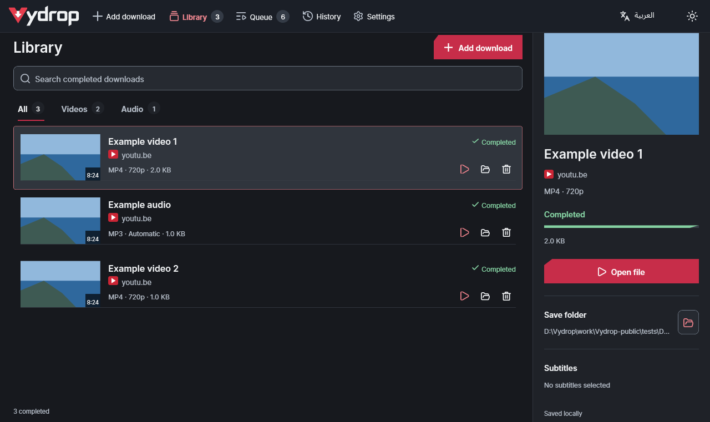
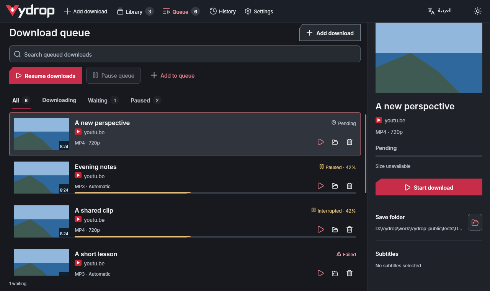
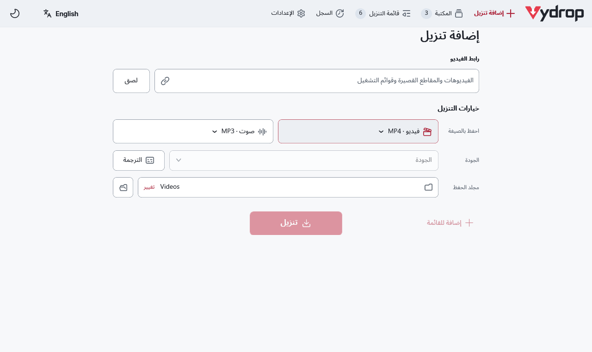
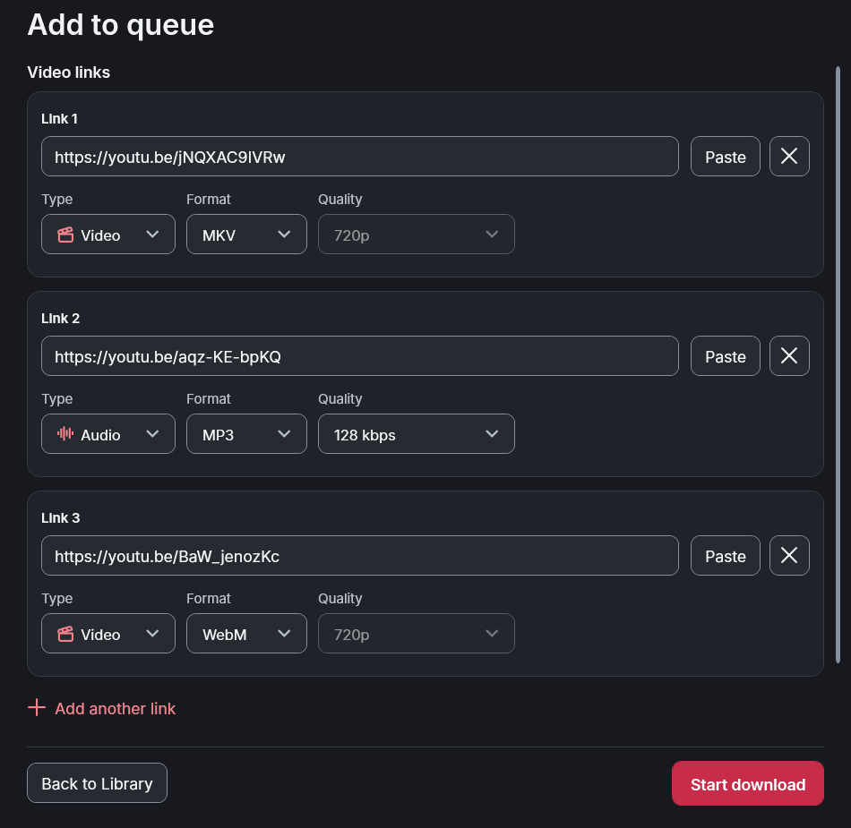
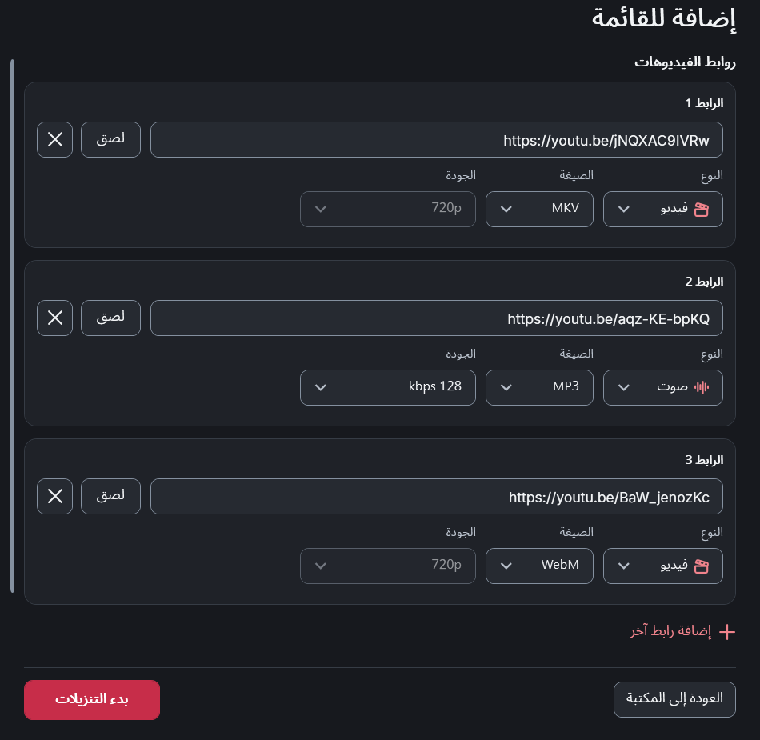
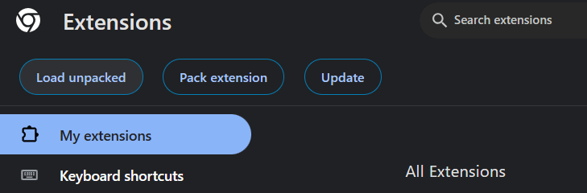
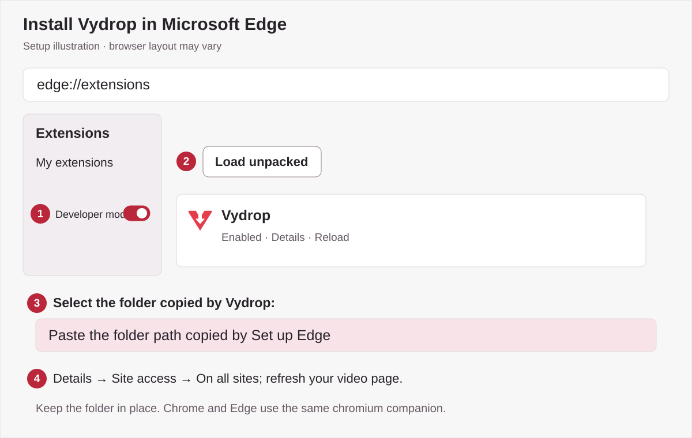
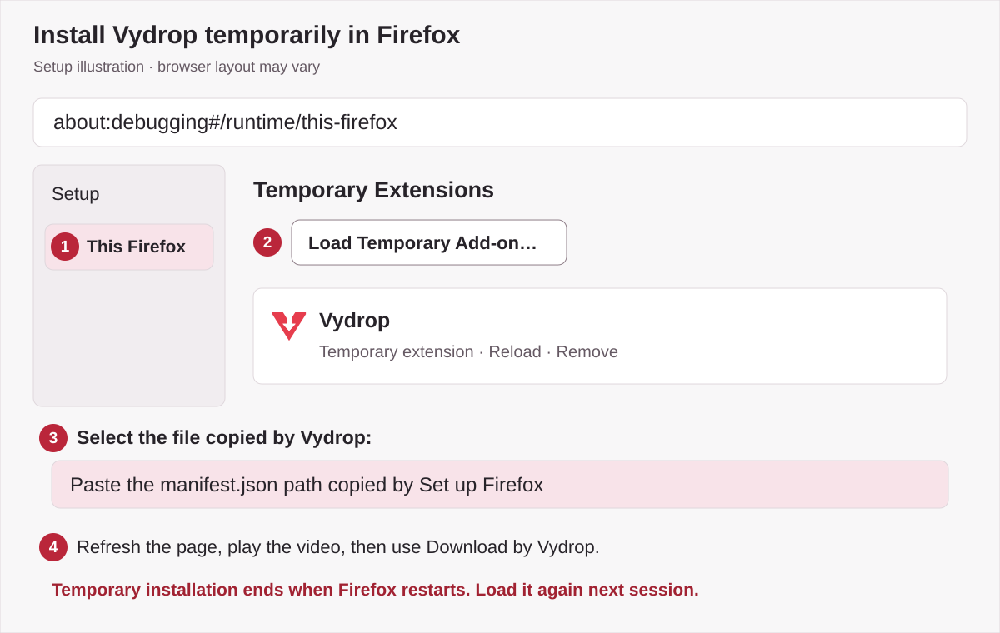

<p align="center"><picture><source media="(prefers-color-scheme: dark)" srcset="assets/brand-logo-dark.svg"></picture></p>

<p align="center">
  <a href="https://github.com/ZiadHassanein/Vydrop/releases/download/v4.4.17/Vydrop-v4.4.17-win-x64.zip"></a>
  <br>
  <br><br>
  <a href="https://github.com/ZiadHassanein/Vydrop/releases"></a>
</p>

<a id="theme-previews"></a>

<p align="center">
  <a href="docs/images/screenshots/vydrop-dark-en-manager.png"></a>
  <a href="docs/images/screenshots/vydrop-light-ar-manager.png"></a>
</p>

<p align="center"><em>Native client renders of Vydrop 4.4.17 with synthetic example downloads and placeholder artwork, without a pointer. The Chrome setup guide uses real screenshots; Edge and Firefox diagrams are labelled illustrations.</em></p>

# Vydrop — Free Video & Audio Downloader for Windows

**Vydrop (formerly ViFree)** is a free, open-source Windows video and audio downloader by **Ziad Hassanein**. Download public media from YouTube, TikTok, Facebook, Vimeo and 1,000+ sites supported by yt-dlp, plus compatible direct media links. English and Arabic, playlists, queues, subtitles and an optional browser companion are included.

[Documentation](https://ziadhassanein.github.io/Vydrop/) · [العربية](https://ziadhassanein.github.io/Vydrop/ar/) · [Setup guide](#getting-started) · [Theme previews](#theme-previews) · [Extension setup with pictures](https://ziadhassanein.github.io/Vydrop/browser-extension-setup.html) · [Report a download problem](https://github.com/ZiadHassanein/Vydrop/issues)

Website guides: [English (US)](docs/en-us/index.md) · [Français](docs/fr/index.md) · [Deutsch](docs/de/index.md) · [Español](docs/es/index.md) · [Arabic terminology across 22 countries](docs/ar/arabic-regional-guide.md). The desktop interface supports English and Arabic.

[Download and install](docs/download.md) · [Troubleshooting](docs/troubleshooting.md) · [About Vydrop, its maintainer and privacy](docs/about.md) · [التنزيل والتشغيل](docs/ar/download.md) · [حل المشكلات](docs/ar/troubleshooting.md)

## Latest release: Vydrop 4.4.17

Vydrop 4.4.17 bundles companion **1.5.14** and a refreshed English/Arabic interface. Navigation sits beside the logo in one compact row, with red hover and selection feedback. Queue links discover their available formats and qualities automatically and keep independent output choices. Add download is cleaner, Library folder actions reveal the saved file, and audio artwork and subtitle search are improved.

The companion follows the app language. Browser integration is in **Settings → Browser integration**. Download later and queue reorder arrows have been removed; older schedule times are retired while queued jobs, history and saved media are preserved.

The main download is the **complete ZIP**, containing **Vydrop.exe**, **Browser/chromium** and **Browser/firefox** with companion **1.5.14**. Extract the entire folder before opening the app. The app connection registers automatically when you open Vydrop. Browser-store listings remain pending; load the bundled companion from **Settings → Browser integration → choose your browser → Set up** until those listings are approved.

Vydrop keeps completed files in **Library** and unfinished work in **Queue**. The updated download workspace centers Download with Cancel beside it, adds Back to Subtitles, and allows changing language during transfers. Browser integration uses compact browser tabs and one Set up action.

<p align="center">
  <a href="docs/images/screenshots/vydrop-dark-en-queue.png"></a>
  <a href="docs/images/screenshots/vydrop-light-ar-download.png"></a>
</p>

<p align="center">
  <a href="docs/images/screenshots/queue-links-en.png"></a>
  <a href="docs/images/screenshots/queue-links-ar.png"></a>
</p>

| Channel | Version | What to use |
| --- | --- | --- |
| Latest stable release | Vydrop 4.4.17 | The complete ZIP linked above, including both browser companions. |
| Included companion | Vydrop 1.5.14 | Chrome, Edge and Firefox folders inside Browser. |

This is the official repository for Vydrop source code, Windows downloads, release notes and support. The source is MIT licensed.

For a readable copy outside GitHub, use the [documentation website](https://ziadhassanein.github.io/Vydrop/). The [plain-text reference](https://ziadhassanein.github.io/Vydrop/llms-full.txt) combines the English and Arabic guides, this README and security notes for readers and tools that cannot load GitHub. It is generated from the same sources, with links back to the originals.

## Download from YouTube and 1,000+ sites

### At a glance

<!-- facts:start -->
**Vydrop (formerly ViFree and YouTube Downloader)** is a free, MIT-licensed video and audio downloader for Windows 10/11 x64. Version **4.4.17** uses yt-dlp for public pages from 1,000+ supported sites, including YouTube, TikTok, Facebook, Vimeo, X/Twitter, Reddit, Dailymotion and Twitch clips, plus direct MP4/MP3 links. Video outputs: MP4, MKV, WebM. Audio outputs: MP3, M4A, Opus, WAV, FLAC. It supports playlists, queues, SRT/VTT subtitles, an optional browser companion, English and Arabic. Private, sign-in-only and DRM-protected media are unsupported. Settings, history and media tools stay locally in `%LocalAppData%\YouTubeDownloader`; downloads use your chosen folder. Vydrop has no telemetry.
<!-- facts:end -->

Vydrop retains these download features:

| Task | Support |
| --- | --- |
| Supported public sites | YouTube, TikTok, Facebook, Vimeo, X/Twitter, Reddit, Dailymotion, Twitch clips and other yt-dlp-supported pages; compatible direct MP4/MP3 links. [Scope and limits](docs/supported-sites.md). |
| Download video | Public videos, Shorts and playlist entries; MP4, MKV and WebM when inspected streams fit the chosen container. |
| Save audio | MP3, M4A, Opus, WAV and FLAC. Conversion bitrate choices respect the reported source estimate; unknown sources offer Automatic. |
| Manage playlists and queues | Choose playlist entries, add individual links to a queue, follow progress and open completed files in their folder. |
| Save subtitles | Choose an available subtitle language and SRT or VTT format. The media details show the selection. |
| Review a link | Preview title, duration, artwork and measured quality before downloading. |
| Use your language | English/LTR and Arabic/RTL, light and dark themes, and keyboard-accessible controls. |
| Prepare media tools | Reuse compatible installed tools or automatically download and verify missing yt-dlp, FFmpeg/FFprobe and Deno tools. |

Quality depends on the source. A higher output bitrate or a lossless file does not restore detail missing from the original audio. Video choices reflect inspected or measured formats.

## Browser extension: Download by Vydrop

Ordinary app startup configures the browser connection automatically. Browser-store listings are not published yet: open **Settings → Browser integration**, choose Chrome, Edge or Firefox and click **Set up**. Finish loading the bundled companion in your browser, then refresh a video page and click its Vydrop button. **Connection help** keeps manual recovery actions available.

The optional **Chrome, Microsoft Edge and Firefox** companion **1.5.14** is in the Vydrop 4.4.17 ZIP's `Browser` folder. Its **Download by Vydrop** button sits inside the video's top-right corner. Open it, choose Video or Audio, format and quality, then select **Download**. This explicit confirmation starts the download in Vydrop's saved folder and can launch the closed app. Older app versions fall back to reviewing the link in Vydrop.

Facebook, TikTok and YouTube detection uses the selected player's public permalink. Other HTML5 players may provide a direct media URL or a single-video page link. Available space, custom players and site restrictions can limit detection. Use the toolbar popup when the tab cannot be placed safely.

Follow the **[illustrated extension setup guide](https://ziadhassanein.github.io/Vydrop/browser-extension-setup.html)** for Chrome, Edge and Firefox, including [Arabic instructions](https://ziadhassanein.github.io/Vydrop/ar/browser-extension-setup.html). See [permissions and limitations](browser/README.md) for more detail. The extension does not import accounts or cookies and does not start hidden downloads. Reload an older unpacked companion after updating its folder, or load the new ZIP's `Browser` companion.

Prefer a walkthrough? [Watch or download the 1080p setup video](docs/media/vydrop-extension-setup.mp4). It includes English narration and embedded English/Arabic captions, from connecting the app to sending your first video.


Start in the app with **Settings → Browser integration**, choose your browser, then select **Set up Chrome**, **Set up Edge** or **Set up Firefox**. Vydrop connects the app, copies the correct extension path and opens the browser's setup page. Complete the browser's loading step below:

| Browser | Open this address | Install from the extracted folder |
| --- | --- | --- |
| [Chrome guide](https://ziadhassanein.github.io/Vydrop/browser-extension-setup.html#chrome) | `chrome://extensions` | Developer mode → Load unpacked → `Browser/chromium` |
| [Edge guide](https://ziadhassanein.github.io/Vydrop/browser-extension-setup.html#edge) | `edge://extensions` | Developer mode → Load unpacked → `Browser/chromium` |
| [Firefox guide](https://ziadhassanein.github.io/Vydrop/browser-extension-setup.html#firefox) | `about:debugging#/runtime/this-firefox` | Load Temporary Add-on → `Browser/firefox/manifest.json` |

<p align="center">
  <a href="https://ziadhassanein.github.io/Vydrop/browser-extension-setup.html#chrome"></a>
  <a href="https://ziadhassanein.github.io/Vydrop/browser-extension-setup.html#edge"></a>
  <a href="https://ziadhassanein.github.io/Vydrop/browser-extension-setup.html#firefox"></a>
</p>

Keep the extracted folder, allow access to the desired websites and refresh open video pages. **Firefox's local add-on must be loaded again after a browser restart.** These packages are not browser-store listings. The [full illustrated guide](https://ziadhassanein.github.io/Vydrop/browser-extension-setup.html) covers every step, updates and troubleshooting.

## Getting started

1. Download the [complete ZIP](https://github.com/ZiadHassanein/Vydrop/releases/download/v4.4.17/Vydrop-v4.4.17-win-x64.zip), extract the entire folder and open **Vydrop.exe**. Keep **Browser/chromium** and **Browser/firefox** beside the app. Target platform: Windows 10/11 x64; the .NET runtime is bundled.
2. Choose **Add download**, paste a video or playlist link, select output, quality and a save folder, then click **Download**. Queue shows the new transfer and its controls.
3. Choose the Video/Audio format buttons and **Subtitles** for captions. Use **Choose videos** for playlist entries and **Queue** for multiple links.

Internet access is required for downloads and missing-tool preparation. No account, API key or paid service is required. Only save media you have permission to download; DRM-protected and sign-in-only content is unsupported.

**Upgrading from ViFree or YouTube Downloader to Vydrop:** close the old app and extract the Vydrop ZIP into a new writable folder once. Stable preferences, history and verified media tools retain their existing storage location. Enable Browser integration from Vydrop to refresh the executable path. Existing companion IDs and permissions are retained.

**App and companion updates:** use **Settings → Check for updates → Install** to update the app and both bundled extensions together. Reload the extension and refresh video tabs afterward; compatible settings, queue, history and downloads are kept.

**App updates after the repository rename:** versions through 4.2.1 need one manual download from the [releases page](https://github.com/ZiadHassanein/Vydrop/releases). Current versions use the Vydrop update endpoint. Extract the new ZIP and enable Browser integration again if the app moved.

## Frequently asked questions

<!-- faq:start -->
### Can Vydrop download videos from sites other than YouTube?

Yes. Vydrop uses yt-dlp for public pages from 1,000+ supported sites, including TikTok, Facebook, Vimeo, X/Twitter, Reddit, Dailymotion and Twitch clips. Direct MP4/MP3 links also work. Site changes and access restrictions can prevent a particular download.

### Is there a free open-source Windows downloader with Arabic?

Yes. Vydrop is free under the MIT license, runs on Windows 10/11 x64, and includes English and Arabic interfaces with light and dark themes. The .NET runtime is bundled; missing media tools are prepared automatically.

### Does Vydrop download TikTok, Facebook, Vimeo or X videos?

Yes, when the public video is supported by yt-dlp and available without signing in. Paste the video’s own link, not the homepage. The extension can resolve a playing video, but custom players and site restrictions can limit detection.

### Can I download a video playing in my browser?

Use the optional Chrome, Edge or Firefox companion. Click Download by Vydrop inside the playing video, choose Video or Audio, format and quality, then confirm Download. Vydrop starts that output in your saved folder, even if the app was closed. Older app versions open a review screen. Detection varies by website.

### How do I save a YouTube playlist as MP3 on Windows?

Paste a public playlist link, choose Whole playlist, select the entries, choose Audio → MP3 and an available audio quality, then choose Download. The app processes the selected entries in order. Available quality depends on the original audio.

### Does Vydrop need an account, API key or subscription?

No. Vydrop needs no account, API key or paid subscription. It contacts media sites and official update servers when needed. It does not import browser cookies, bypass sign-in or decrypt DRM. Only download media you have permission to save.

### What happens when a website changes?

Vydrop checks for verified yt-dlp and Deno updates once daily when starting a download and can try one compatible update-and-retry. A site may still require an upstream fix. Use Settings → Update downloader for a manual check; application updates are separate.
<!-- faq:end -->

## Why Vydrop?

| Task | Vydrop | yt-dlp command line | Web converters |
| --- | --- | --- | --- |
| Multiple public sites | yt-dlp support in one window | yt-dlp support | Depends on the service |
| Controls | English/Arabic desktop UI | Command arguments | Browser form; varies |
| Media tools | Missing tools prepared automatically | User manages tools | Service manages tools |
| Playlists, captions, queue | App controls | Command options and scripts | Depends on the service |
| Cost and advertising | Free, no ads | Free, no ads | Pricing and ads vary |
| Browser handoff | Optional companion | Requires another integration | Varies |

Each web service differs. This compares workflows, not other products’ safety.

## Build from source

### Download reliability preview on this branch

The queue saves type, format, quality and transfer settings for each job. Pause/Resume and restart recovery remain available, and interrupted jobs wait for your action. Browser actions can add work while another job runs. Queue scheduling and manual reorder arrows have been removed without deleting existing jobs or history.

Companion 1.5.14 keeps the popup focused on **Open in Vydrop** and **Add to download queue**. Connection checks remain in the desktop app. The companion no longer includes optional media-stream discovery or its observation permissions. Older companions and hosts retain version-1 link sending; capabilities requiring the new app are unavailable on an older host.

HLS/DASH downloads can use 1, 2, 4 or 8 parallel fragments with an optional speed limit. Opt-in direct-MP4 acceleration requires correct byte ranges and a strong ETag, validates ranges and media before promoting the completed file, and keeps partial chunks for safe resume. Unsupported files use the existing downloader. Expired browser sources with a recognized video identity can be refreshed from their original page. Unidentified sources must be added again. Changed URLs restart in a separate partial generation rather than appending to unverified bytes.

Queued URLs (including any signed media query), source pages, output choices and completion paths are saved in `queue.json` and its previous-state backup inside the existing local app data directory. Preview builds use `ViFreePreview`; stable builds keep `YouTubeDownloader`. Removing a job updates the current queue; a previous-state backup may retain it until replaced. No queue data is sent to an analytics service.

Use `scripts/package.ps1 -Preview -Version 4.4.17-preview.1` for a separate test build. `scripts/package-browser.ps1 -StorePackages` prepares unsigned store upload archives and a readiness report. Store publication, permanent Firefox signing and desktop Authenticode signing still need publisher accounts, assigned store IDs and a code-signing certificate. `scripts/sign-desktop.ps1` supports an explicitly selected certificate; it never creates trust certificates or exports private keys. The published 4.4.17 complete ZIP is the stable download.

On Windows, install the **.NET 10 SDK**. **Node.js 20+** is also required for browser-companion tests.

```powershell
./scripts/check.ps1
./scripts/package.ps1 -Version 4.4.17
```

The solution contains `Downloader.Core`, `Downloader.Infrastructure` and the WPF `Downloader.Desktop` project. See [Security](SECURITY.md) for supported media and update limitations.

The check command includes core, infrastructure, WPF, checking-feedback, isolated shutdown, simulated system-theme, virtualized playlist selection, browser, localization and documentation checks. System-theme tests inject colours without changing Windows accessibility settings. Set `VYDROP_PLAYWRIGHT` to an installed Playwright module to also run the synthetic headless Edge overlay checks; these use an isolated browser profile and a simulated native connection.

## Vydrop بالعربية — برنامج تنزيل الفيديو والصوت لويندوز

<div dir="rtl" lang="ar">

**Vydrop** برنامج مجاني ومفتوح المصدر من تطوير **زياد حسنين**، لتنزيل الفيديو والصوت من الصفحات العامة في يوتيوب وتيك توك وفيسبوك وVimeo وأكثر من ١٠٠٠ موقع مدعوم عبر yt-dlp، إضافة إلى روابط الوسائط المباشرة. يدعم العربية والإنجليزية والمظهرين الفاتح والداكن، مع قائمة تنزيلات واختيار فيديوهات القائمة وحفظ الترجمة المتاحة.

الإصدار الحالي هو **Vydrop 4.4.17**، ويجهّز ربط التطبيق تلقائيًا، وتحسينات لإرسال الفيديو من المتصفح، وحفظ قائمة التنزيلات واستئنافها وجدولتها، وأيقونات أوضح وواجهة محسّنة بالعربية والإنجليزية مع الحفاظ على الإعدادات والسجل والتوافق السابق. تتضمن الحزمة إضافة المتصفح **1.5.14**. [نزّل ملف ZIP الكامل](https://github.com/ZiadHassanein/Vydrop/releases/download/v4.4.17/Vydrop-v4.4.17-win-x64.zip)، وفكّه كاملًا ثم افتح **Vydrop.exe** مع الاحتفاظ بمجلد **Browser** وإضافتَي Chromium وFirefox. تُجهّز الأدوات الناقصة تلقائيًا، ولا يلزم حساب أو مفتاح API أو خدمة مدفوعة. اختر متصفحك من إعدادات الربط وأكمل تحميل الإضافة من مجلد Browser الجديد. راجع [دليل تفعيل Chrome وEdge وFirefox بالصور](https://ziadhassanein.github.io/Vydrop/ar/browser-extension-setup.html). تختلف إمكانية التنزيل حسب الموقع وإتاحة الفيديو وجودة المصدر.

### أسئلة شائعة

### هل ينزّل Vydrop الفيديو من مواقع غير يوتيوب؟

نعم. يستخدم Vydrop أداة yt-dlp للصفحات العامة في أكثر من ١٠٠٠ موقع مدعوم، منها تيك توك وفيسبوك وVimeo وX وReddit وDailymotion ومقاطع Twitch، إضافة إلى روابط MP4 وMP3 المباشرة. قد تمنع تغييرات الموقع أو قيود الوصول تنزيل رابط معيّن.

### هل يوجد برنامج تنزيل مجاني ومفتوح المصدر لويندوز بواجهة عربية؟

نعم. Vydrop مجاني بترخيص MIT ويعمل على Windows 10/11 x64، مع واجهتين عربية وإنجليزية ومظهرين فاتح وداكن. بيئة .NET مضمّنة، وتُجهّز أدوات الوسائط الناقصة تلقائيًا.

### هل يدعم Vydrop فيديوهات تيك توك وفيسبوك وVimeo وX؟

نعم، عندما يكون الفيديو عامًا ومدعومًا عبر yt-dlp ومتاحًا دون تسجيل دخول. الصق رابط الفيديو نفسه بدل الصفحة الرئيسية. تستطيع الإضافة تحديد الفيديو الجاري تشغيله، لكن بعض المشغّلات وقيود المواقع قد تمنع اكتشافه.

### هل يمكن تنزيل الفيديو الذي أشاهده في المتصفح؟

استخدم إضافة Chrome أو Edge أو Firefox الاختيارية. اضغط «تنزيل بواسطة Vydrop» داخل الفيديو الجاري تشغيله، واختر فيديو أو صوتًا والصيغة والجودة، ثم أكّد التنزيل. يبدأ الاختيار في مجلد الحفظ حتى إذا كان التطبيق مغلقًا. تفتح الإصدارات الأقدم شاشة المراجعة، وقد يختلف الاكتشاف بحسب الموقع.

### كيف أحفظ قائمة تشغيل يوتيوب بصيغة MP3 على ويندوز؟

الصق رابط قائمة عامة، واختر القائمة كاملة ثم الفيديوهات المطلوبة. اختر الصوت ثم MP3 وجودة الصوت المتاحة، واضغط تنزيل. يعالج التطبيق العناصر المحددة بالترتيب، وتعتمد الجودة على الصوت الأصلي.

### هل يحتاج Vydrop إلى حساب أو مفتاح API أو اشتراك؟

لا. لا يحتاج Vydrop إلى حساب أو مفتاح API أو اشتراك مدفوع. يتصل بمواقع الوسائط وخوادم التحديث الرسمية عند الحاجة، ولا يستورد ملفات تعريف الارتباط أو يتجاوز تسجيل الدخول أو يفك DRM. نزّل فقط ما تملك إذنًا بحفظه.

### ماذا يحدث عندما يغيّر موقع طريقة عمله؟

يفحص Vydrop تحديثات yt-dlp وDeno المتحقق منها مرة يوميًا عند بدء التنزيل، وقد يحدّث الأدوات ويعيد المحاولة مرة واحدة عند خطأ متوافق. قد يظل الحل بحاجة إلى إصلاح من المطوّرين الأصليين. للفحص اليدوي اختر الإعدادات ثم تحديث أداة التنزيل؛ تحديث التطبيق منفصل.

[الأدلة العربية](docs/ar/index.md) · [المواقع والقيود](docs/ar/supported-sites.md)

</div>

## Author and support

Created by **Ziad Hassanein**. [GitHub](https://github.com/ZiadHassanein) · [LinkedIn](https://www.linkedin.com/in/ziad-hassanein/) · [Email](mailto:ziadmuhammed501@gmail.com).

Use [GitHub issues](https://github.com/ZiadHassanein/Vydrop/issues) for app problems and development reports. Include your app version, Windows version and the public link involved; never post passwords or cookies.
