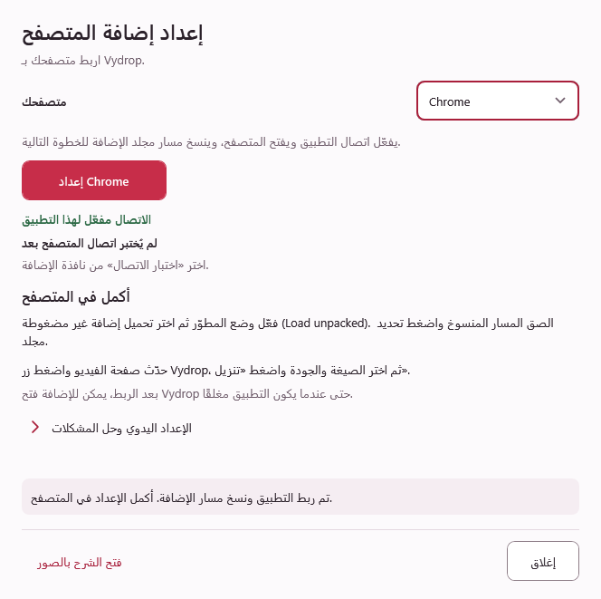

# إعداد إضافة Vydrop في Chrome وEdge وFirefox

الإضافة اختيارية ومجانية؛ تنسخ رابط الفيديو الجاري تشغيله وتفتحه في Vydrop للمراجعة. لا يبدأ التنزيل تلقائيًا ولا تُستورد بيانات الحساب.

شرح إعداد التطبيق وChrome وإرسال الفيديو يستخدم **لقطات حقيقية** بواجهة إنجليزية، محفوظة كملفات PNG الأصلية، مع تحديد الأزرار المطلوبة. اختر **كبّر التفاصيل بالحجم الأصلي** أسفل أي صورة لقراءة الأزرار دون تصغيرها، ومرّر داخل العرض المكبّر، أو اضغط الصورة لفتح الأصل. صور Edge وFirefox رسومات توضيحية مذكورة بوضوح.

**لمستخدمي المُثبّت:** [مُثبّت Vydrop 4.4.3](https://github.com/ZiadHassanein/Vydrop/releases/download/v4.4.3/VydropSetup-v4.4.3-win-x64.exe) يجهّز ربط التطبيق تلقائيًا. لم تُنشر الإضافة في متاجر المتصفحات بعد. افتح **الإعدادات ← الربط بالمتصفح ← الإعداد اليدوي وحل المشكلات ← تحميل الإضافة المحلية**، وأكمل التحميل في المتصفح، ثم استخدم **اختبار الاتصال**. تظل خطوات النسخة المحمولة أدناه متاحة أيضًا.
## شاهد فيديو الإعداد

<figure class="setup-video">
  <video controls playsinline preload="none" width="1920" height="1080" poster="../images/extension/video/poster.jpg" aria-label="شرح إعداد إضافة Vydrop في Chrome وEdge وFirefox">
    <source src="../media/vydrop-extension-setup.mp4" type="video/mp4">
    <track kind="captions" src="../media/vydrop-extension-setup.en.vtt" srclang="en" label="English">
    <track kind="captions" src="../media/vydrop-extension-setup.ar.vtt" srclang="ar" label="العربية" default>
    <track kind="chapters" src="../media/vydrop-extension-setup.chapters.vtt" srclang="en" label="الفصول بالإنجليزية">
    يمكنك تنزيل ملف MP4 من الرابط التالي.
  </video>
  <figcaption>يعرض الفيديو خطوات النسخة المحمولة 4.2.5؛ يجهّز المُثبّت الجديد ربط التطبيق تلقائيًا. شرح صوتي بالإنجليزية مع ترجمة عربية وإنجليزية. يستخدم نافذة إعداد النسخة المحمولة القديمة وصورًا توضيحية للمتصفحات مذكورة بوضوح. افتح العرض الكامل لرؤية الأزرار بوضوح، واختر العربية من زر الترجمة عند الحاجة.</figcaption>
</figure>

[تنزيل فيديو الإعداد (MP4)](../media/vydrop-extension-setup.mp4) · [الترجمة العربية](../media/vydrop-extension-setup.ar.vtt) · [English captions](../media/vydrop-extension-setup.en.vtt)

يوضح الفيديو فك الضغط، وربط التطبيق، واختيار مجلد Chrome وEdge الصحيح، وتثبيت Firefox المؤقت، وإرسال أول فيديو عام إلى Vydrop. تشرح الخطوات المكتوبة التالية الإعداد نفسه.

## الإعداد السريع

1. **فكّ ضغط الحزمة كاملة** في مجلد دائم، وافتح **Vydrop.exe** مع الاحتفاظ بمجلد **Browser** بجانبه.
2. افتح **الإعدادات ← الربط بالمتصفح**. في النسخ الأقدم اضغط **تفعيل الاتصال**، أو **إعادة تفعيل الاتصال** إذا كان مفعّلًا بالفعل. تؤكد الحالة ربط تطبيق سطح المكتب فقط؛ يجب تحميل الإضافة في المتصفح أيضًا.
3. **حمّل الإضافة** وفق الجدول التالي. في Vydrop 4.4.0 وما بعده، اختر متصفحك واضغط **إعداد Chrome** أو **إعداد Edge** أو **إعداد Firefox**؛ يربط الزر التطبيق وينسخ المسار الصحيح ويفتح صفحة المتصفح. تبقى الأزرار المنفصلة داخل **الإعداد اليدوي وحل المشكلات**. في النسخ الأقدم، فعّل الاتصال واستخدم العناوين والملفات نفسها، وانسخ المسار من مستكشف الملفات.
4. **أغلق الإعداد وحدّث صفحة الفيديو وشغّله.** اضغط زر Vydrop، وراجع الفيديو داخل التطبيق، ثم اضغط «تنزيل».

| المتصفح | العنوان المطلوب كتابته في المتصفح نفسه | طريقة التحميل | المطلوب اختياره |
| --- | --- | --- | --- |
| [Chrome](#chrome) | `chrome://extensions` | Developer mode ثم Load unpacked | مجلد **Browser\chromium** |
| [Edge](#edge) | `edge://extensions` | Developer mode ثم Load unpacked | مجلد **Browser\chromium** نفسه |
| [Firefox](#firefox) | `about:debugging#/runtime/this-firefox` | This Firefox ثم Load Temporary Add-on… | ملف **Browser\firefox\manifest.json** |

الصق المسار المنسوخ في شريط عنوان نافذة اختيار الملفات واضغط **Enter**. يحتاج Chrome وEdge إلى **مجلد**، بينما يحتاج Firefox إلى **ملف**. يلزم تأكيد التحميل داخل المتصفح. تثبيت Firefox محلي ومؤقت، ويحتاج إلى تحميل الإضافة مجددًا بعد إعادة تشغيله.

إذا تعذّر فتح المتصفح من التطبيق، اضغط **نسخ عنوان صفحة الإضافات** والصقه في شريط عنوان المتصفح. إذا كانت أزرار المسار معطّلة، فكّ ضغط حزمة البرنامج **كاملة**؛ نسخ Vydrop.exe وحده لا يتضمن ملفات الإضافة.

## الشرح بالصور: جهّز التطبيق

تُظهر لقطات Chrome الإضافة 1.3.5. تستخدم الإضافة المرفقة 1.5.1 خطوات الإعداد نفسها؛ تأكد من ظهور الإصدار الجديد بعد تحميلها أو إعادة تحميلها.

نزّل [أحدث إصدار رسمي](https://github.com/ZiadHassanein/Vydrop/releases/latest) وفكّ الضغط في مجلد دائم قابل للكتابة. تتضمن حزمة **Vydrop 4.4.3** إضافة **1.5.1**. افتح **Vydrop.exe** واحتفظ بمجلد **Browser** بجانبه. اسم المجلد وحرف القرص في الصور مجرد مثال؛ استخدم مكان فك الضغط عندك.



في Vydrop 4.4.3 افتح **الإعدادات ← الربط بالمتصفح**، واختر متصفحك، ثم اضغط **إعداد Chrome** أو **إعداد Edge** أو **إعداد Firefox**. يربط الزر التطبيق وينسخ مسار الإضافة المناسب ويفتح صفحة إعداد المتصفح. الصق المسار المنسوخ عندما يطلب المتصفح اختيار الإضافة، ثم حدّث صفحة الفيديو بعد إكمال التحميل.

في النسخ الأقدم استخدم **تفعيل الاتصال** أو **إعادة تفعيل الاتصال** ثم خطوات تحميل الإضافة يدويًا. تبقى هذه الإجراءات المنفصلة في النافذة الحالية داخل **الإعداد اليدوي وحل المشكلات**. عند نقل التطبيق، أعد الإعداد من مكانه الجديد.

## Google Chrome

### افتح صفحة الإضافات

اكتب `chrome://extensions` في شريط العنوان، أو افتح قائمة Chrome ذات النقاط الثلاث ثم **Extensions → Manage extensions**.



### فعّل وضع المطوّر واضغط Load unpacked

فعّل **Developer mode** في صفحة الإضافات، ثم اضغط **Load unpacked** لتحميل إضافة غير مضغوطة. اللقطة التالية مركّزة على زر التحميل؛ مفتاح وضع المطوّر خارج حدودها.



### انسخ مسار مجلد الإضافة الصحيح

داخل ملفات Vydrop المستخرجة افتح **Browser** ثم **chromium**. اضغط شريط العنوان في مستكشف الملفات وانسخ المسار الكامل. لازم ينتهي بـ **Browser\chromium** ويحتوي المجلد على ملف **manifest.json**.



### اختر المجلد من نافذة Chrome

في نافذة **Select the extension directory** الصق المسار الكامل في شريط العنوان واضغط **Enter**. تأكد أنه ينتهي بـ **Browser\chromium**، ثم اضغط **Select Folder**.

اللقطة التالية تعرض النافذة قبل إكمال المسار. **لا تختَر مجلد Vydrop الرئيسي الظاهر في شريطها**؛ أضف **\Browser\chromium** أو الصق المسار الكامل من الخطوة السابقة قبل الضغط على Select Folder. كذلك لا تختَر ملف ZIP أو مجلد Browser الخارجي فقط.



### تأكد من تشغيل الإضافة

تأكد من ظهور بطاقة **Vydrop 1.5.1** وأن مفتاحها مفعّل. من **Details → Site access** اسمح بالوصول للمواقع المطلوبة؛ خيار **On all sites** يتيح الاكتشاف على المواقع المدعومة. يمكنك تثبيت زر الإضافة في شريط المتصفح إن رغبت.



بعد التثبيت أعد تحميل صفحات الفيديو المفتوحة. [تعليمات Chrome الرسمية](https://developer.chrome.com/docs/extensions/get-started/tutorial/hello-world#load-unpacked).

## Microsoft Edge

1. افتح `edge://extensions` وفعّل وضع المطوّر.
2. اختر **Load unpacked** ثم `Browser/chromium` نفسه؛ لا تختَر ملف ZIP.
3. وافق على الوصول للمواقع المطلوبة وأعد تحميل صفحة الفيديو.

## Mozilla Firefox

1. افتح `about:debugging#/runtime/this-firefox`.
2. اختر **Load Temporary Add-on** ثم `Browser/firefox/manifest.json`.
3. وافق على الأذونات المطلوبة وأعد تحميل صفحة الفيديو.

**هذه إضافة محلية مؤقتة وتحتاج إلى تحميلها من جديد بعد إعادة تشغيل Firefox.** الحزم المحلية ليست منشورة في متجر المتصفح.

## اختر الفيديو والصيغة والجودة

حدّث صفحة الفيديو وشغّله، ثم اضغط **Download by Vydrop** داخل الزاوية العلوية اليمنى للفيديو، أو افتح الإضافة من شريط المتصفح.



اختر **فيديو** أو **صوت**، ثم الصيغة والجودة المتاحة، واضغط **تنزيل**. يبدأ الاختيار المؤكد في مجلد الحفظ الذي اخترته في Vydrop، ويمكنه فتح التطبيق إذا كان مغلقًا. تحتفظ التنزيلات الأخرى في القائمة بحالتها.



## راجع مجلد الحفظ أو غيّره

افتح **إضافة تنزيل** في Vydrop لاختيار مجلد الحفظ وفحص رابط بنفسك. قد تفتح إصدارات التطبيق الأقدم شاشة المراجعة بدل بدء التنزيل. حدّث التطبيق وأعد تحميل الإضافة لاستخدام قائمة الجودة الجديدة. اكتشاف الرابط لا يضمن إمكانية تنزيل كل فيديو.



## حل المشكلات

| ما الذي يظهر؟ | الحل |
| --- | --- |
| الاتصال مفعّل لكن الإضافة غير موجودة | الحالة تؤكد اتصال تطبيق سطح المكتب فقط. حمّل الإضافة في المتصفح المختار وحدّث صفحة الفيديو. |
| تعذّر فتح المتصفح من الإعداد | انسخ عنوان صفحة الإضافات الموضّح في التطبيق والصقه في شريط عنوان المتصفح نفسه. |
| أزرار نسخ المسار وعرض الملفات معطّلة | فكّ ضغط حزمة Vydrop كاملة واحتفظ بمجلد Browser بجوار Vydrop.exe، ثم أعد فتح التطبيق. |

عند تحديث المجلد أعد تحميل الإضافة ثم صفحة الفيديو. إذا كان التطبيق مشغولًا، أنهِ التنزيل الحالي أو ألغِه ثم حاول مجددًا. عند فشل الربط افتح التطبيق وفعّله من الإعدادات. استخدم مجلد Browser من حزمة التطبيق المستقرة نفسها، وتجنّب خلطه مع Preview.

لا تدعم الإضافة كل مشغّل، ولا تعني معرفة الرابط إمكان تنزيل فيديو خاص أو محمي أو يتطلب تسجيل دخول. قد تختلف مواضع الأزرار بحسب إصدار المتصفح. [تعليمات Edge الرسمية](https://learn.microsoft.com/en-us/microsoft-edge/extensions/getting-started/extension-sideloading) · [شرح التثبيت المؤقت في Firefox](https://extensionworkshop.com/documentation/develop/temporary-installation-in-firefox/).

اقرأ [سياسة خصوصية إضافة المتصفح (بالإنجليزية)](../browser-extension-privacy.md) لمعرفة المعلومات المستخدمة، وما يُنقل إلى التطبيق المحلي، وكيف تُحفظ البيانات.
