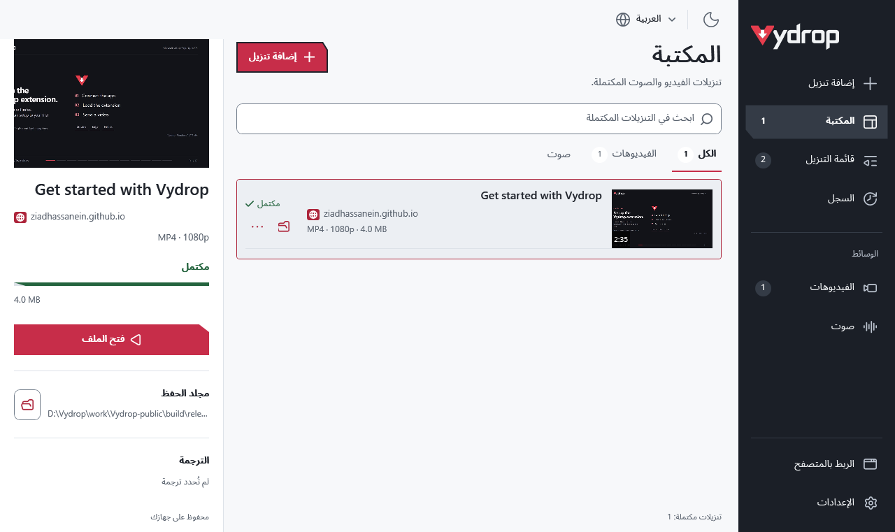
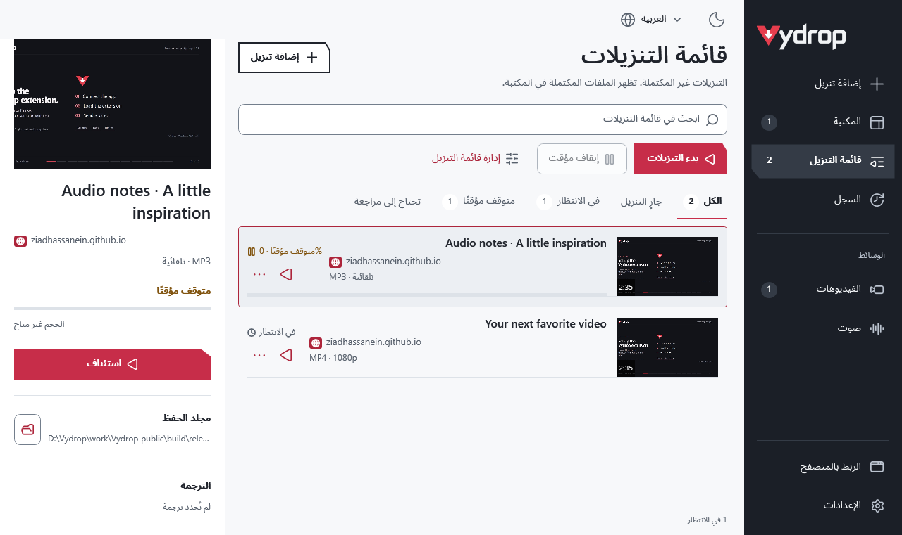

# Vydrop: برنامج مجاني لتنزيل الفيديو والصوت لويندوز

**Vydrop** برنامج مجاني ومفتوح المصدر لتنزيل الفيديو والصوت لويندوز، من تطوير [زياد حسنين](https://github.com/ZiadHassanein). هذا هو الموقع الرسمي للبرنامج؛ [إصدارات ويندوز](download.md) و[الكود المصدري](https://github.com/ZiadHassanein/Vydrop) منشورة ضمن المشروع نفسه.

نزّل من YouTube وTikTok وFacebook وVimeo وأكثر من ١٠٠٠ موقع عبر yt-dlp، بواجهة عربية وإنجليزية.

  <a class="download" href="https://github.com/ZiadHassanein/Vydrop/releases/download/v4.4.6/Vydrop-v4.4.6-win-x64.zip">
    <svg width="26" height="26" viewBox="0 0 32 32" fill="none" stroke="currentColor" stroke-width="2.2" stroke-linecap="round" stroke-linejoin="round" aria-hidden="true"><path d="M16 4v17m-7-7 7 7 7-7M5 23v5h22v-5"/></svg>
    تنزيل <bdi>Vydrop ZIP</bdi><bdi>Windows 10/11 x64 · v4.4.6 · ZIP</bdi>
  </a>
  

تتضمن الحزمة **Vydrop.exe** ومجلد **Browser** بإضافتَي Chromium وFirefox بالإصدار 1.5.4. فكّ ملف ZIP كاملًا قبل تشغيل البرنامج. [مُثبّت ويندوز (اختياري)](https://github.com/ZiadHassanein/Vydrop/releases/download/v4.4.6/VydropSetup-v4.4.6-win-x64.exe).

## معلومات أساسية



<figure><picture><source media="(prefers-color-scheme: dark)" srcset="../images/screenshots/vydrop-dark-ar-manager.png"></picture><figcaption>لقطة أصلية من تطبيق Vydrop 4.4.4 في ويندوز بمقياس ١٠٠٪، مع أمثلة للتنزيلات ودون مؤشر الفأرة.</figcaption></figure>

تحتوي **المكتبة** على ملفات الفيديو والصوت المكتملة. وتجمع **قائمة التنزيلات** المهام المنتظرة والجارية والمتوقفة مؤقتًا والفاشلة، مع بحث مستقل ومرشحات للحالة وأزرار البدء والإيقاف المؤقت. عند بدء تنزيل تُفتح القائمة ويُحدَّد الملف الجاري، ثم يظهر في المكتبة بعد اكتماله. تفتح **إضافة تنزيل** والإعدادات والسجل داخل مساحة العمل نفسها.

<figure><picture><source media="(prefers-color-scheme: dark)" srcset="../images/screenshots/vydrop-dark-ar-queue.png"></picture><figcaption>تجمع قائمة التنزيلات العمل غير المكتمل، وتبقى الملفات المكتملة في المكتبة. لقطة أصلية من التطبيق مع مهام تجريبية.</figcaption></figure>

## إرشادات بلغتك

تتوفر إرشادات [بالعربية](index.md)، و[الإنجليزية الأمريكية](../en-us/index.md)، و[الفرنسية](../fr/index.md)، و[الألمانية](../de/index.md)، و[الإسبانية](../es/index.md). واجهة التطبيق نفسها بالعربية والإنجليزية.

لو بتبحث بإزاي أو كيف أو شلون أو كيفاش، راجع [دليل مصطلحات تنزيل الفيديو في ٢٢ دولة عربية](arabic-regional-guide.md) لمعرفة الاختيار المقابل داخل البرنامج.

## ابدأ برابط فيديو عام

لو بتستخدم البرنامج لأول مرة، راجع [التنزيل والتشغيل والتحديث من المصدر الرسمي](download.md). يوضّح الدليل الفرق بين كود GitHub المصدري وحزمة ويندوز الجاهزة للتشغيل.

1. فكّ ملف ZIP كاملًا، واحتفظ بمجلد **Browser** ثم افتح **Vydrop.exe**. بيئة .NET مضمّنة، ومُثبّت ويندوز خيار بديل.
2. الصق رابط الفيديو نفسه أو رابط قائمة عامة، وراجع العنوان والجودة المتاحة.
3. اختر الفيديو أو الصوت والصيغة ومجلد الحفظ. فعّل **الترجمة** عند توافرها.
4. اضغط **تنزيل** لمتابعة المهمة في **قائمة التنزيلات**. افتح الملفات المكتملة من **المكتبة**، أو استخدم **السجل** لآخر خمسة تنزيلات مكتملة.

قد يُجهّز التطبيق الأدوات الناقصة في الاستخدام الأول. لا يحتاج إلى حساب أو مفتاح API أو اشتراك. نزّل فقط ما تملك إذنًا بحفظه.

## المواقع والصيغ المدعومة

راجع [المواقع والقيود](supported-sites.md). تُرسل الصفحات العامة إلى yt-dlp وتُفحص ملفات الوسائط المباشرة لمعرفة معلوماتها الفعلية. تعتمد النتيجة على إتاحة الموقع والصيغ وجودة المصدر، ولا تستعيد زيادة معدل البت التفاصيل المفقودة.

## الأدلة

- [تنزيل الفيديو من المواقع المدعومة](download-video-from-any-website-windows.md)
- [إرسال فيديو تيك توك أو فيسبوك](tiktok-facebook-video-downloader-windows.md)
- [حفظ صوت يوتيوب بصيغة MP3](youtube-to-mp3-windows.md)
- [تنزيل عناصر قائمة تشغيل](download-youtube-playlist-windows.md)
- [حفظ الترجمة المتاحة بصيغة SRT](youtube-subtitles-srt.md)
- [إعداد Chrome وEdge وFirefox بالصور](browser-extension-setup.md)
- [حل مشكلات فحص الفيديو والإضافة والملفات](troubleshooting.md)
- [عن Vydrop والمصدر والخصوصية](about.md)

## لماذا تطبيق سطح المكتب؟

| المهمة | Vydrop | سطر أوامر yt-dlp | محوّلات الويب |
| --- | --- | --- | --- |
| مواقع عامة متعددة | دعم yt-dlp في نافذة واحدة | دعم yt-dlp | بحسب الخدمة |
| التحكم | واجهة عربية وإنجليزية | أوامر نصية | نموذج في المتصفح؛ يختلف |
| أدوات الوسائط | تجهيز الناقص تلقائيًا | يديرها المستخدم | تديرها الخدمة |
| القوائم والترجمة والتنزيلات | عناصر تحكم داخل التطبيق | خيارات وأوامر | بحسب الخدمة |
| السعر والإعلانات | مجاني دون إعلانات | مجاني دون إعلانات | يختلف بحسب الخدمة |
| الإرسال من المتصفح | إضافة اختيارية | يحتاج تكاملًا آخر | يختلف |

يجمع Vydrop الصيغ والجودة المكتشفة والتقدم والملفات المكتملة في واجهة محلية واحدة. تقارن المعلومات خطوات العمل دون الحكم على أمان المنتجات الأخرى.

## أسئلة شائعة

### هل ينزّل Vydrop الفيديو من مواقع غير يوتيوب؟

نعم. يستخدم Vydrop أداة yt-dlp للصفحات العامة في أكثر من ١٠٠٠ موقع مدعوم، منها تيك توك وفيسبوك وVimeo وX وReddit وDailymotion ومقاطع Twitch، إضافة إلى روابط MP4 وMP3 المباشرة. قد تمنع تغييرات الموقع أو قيود الوصول تنزيل رابط معيّن.

### هل يوجد برنامج تنزيل مجاني ومفتوح المصدر لويندوز بواجهة عربية؟

نعم. Vydrop مجاني بترخيص MIT ويعمل على Windows 10/11 x64، مع واجهتين عربية وإنجليزية ومظهرين فاتح وداكن. بيئة .NET مضمّنة، وتُجهّز أدوات الوسائط الناقصة تلقائيًا.

### هل يدعم Vydrop فيديوهات تيك توك وفيسبوك وVimeo وX؟

نعم، عندما يكون الفيديو عامًا ومدعومًا عبر yt-dlp ومتاحًا دون تسجيل دخول. الصق رابط الفيديو نفسه بدل الصفحة الرئيسية. تستطيع الإضافة تحديد الفيديو الجاري تشغيله، لكن بعض المشغّلات وقيود المواقع قد تمنع اكتشافه.

### هل يمكن تنزيل الفيديو الذي أشاهده في المتصفح؟

استخدم إضافة Chrome أو Edge أو Firefox الاختيارية. اضغط «تنزيل بواسطة Vydrop» داخل الفيديو الجاري تشغيله، واختر فيديو أو صوتًا والصيغة والجودة، ثم أكّد التنزيل. يبدأ الاختيار في مجلد الحفظ حتى إذا كان التطبيق مغلقًا. تفتح الإصدارات الأقدم شاشة المراجعة، وقد يختلف الاكتشاف بحسب الموقع.

### كيف أحفظ قائمة تشغيل يوتيوب بصيغة MP3 على ويندوز؟

الصق رابط قائمة عامة، واختر القائمة كاملة ثم الفيديوهات المطلوبة. اختر الصوت ثم MP3 وجودة الصوت المتاحة، واضغط تنزيل. يعالج التطبيق العناصر المحددة بالترتيب، وتعتمد الجودة على الصوت الأصلي.

### هل يحتاج Vydrop إلى حساب أو مفتاح API أو اشتراك؟

لا. لا يحتاج Vydrop إلى حساب أو مفتاح API أو اشتراك مدفوع. يتصل بمواقع الوسائط وخوادم التحديث الرسمية عند الحاجة، ولا يستورد ملفات تعريف الارتباط أو يتجاوز تسجيل الدخول أو يفك DRM. نزّل فقط ما تملك إذنًا بحفظه.

### ماذا يحدث عندما يغيّر موقع طريقة عمله؟

يفحص Vydrop تحديثات yt-dlp وDeno المتحقق منها مرة يوميًا عند استخدام رابط، وقد يحدّث الأدوات ويعيد المحاولة مرة واحدة عند خطأ متوافق. قد يظل الحل بحاجة إلى إصلاح من المطوّرين الأصليين. للفحص اليدوي اختر الإعدادات ثم تحديث أداة التنزيل؛ تحديث التطبيق منفصل.
