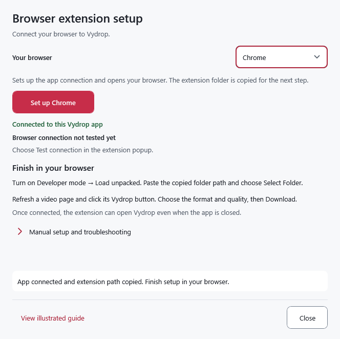

# Set up the Vydrop browser extension

Use the optional companion to send the video you are watching to the desktop app, then review it before downloading. Setup is free. You can also paste a link directly into the app.

**Use the matching package:** [Vydrop 4.4.1 for Windows](https://github.com/ZiadHassanein/Vydrop/releases/download/v4.4.1/Vydrop-v4.4.1-win-x64.zip) includes companion **Vydrop 1.5.0**. Open **Vydrop.exe** and use its included **Browser** folder. When upgrading from ViFree, enable the connection from Vydrop and reload the companion from the new folder.

[Published downloads](https://github.com/ZiadHassanein/Vydrop/releases/latest) · [Chrome](#chrome) · [Edge](#edge) · [Firefox](#firefox) · [Troubleshooting](#troubleshooting) · [العربية](#arabic)

**Installer users:** [Vydrop 4.4.1 Setup](https://github.com/ZiadHassanein/Vydrop/releases/download/v4.4.1/VydropSetup-v4.4.1-win-x64.exe) registers the app connection automatically. The browser stores are not published yet. Open **Settings → Browser integration → Manual setup and troubleshooting → Load the local companion**, finish the browser loading step, then use **Test connection**. The portable instructions below also remain available.
## Watch the setup video

<figure class="setup-video">
  <video controls playsinline preload="none" width="1920" height="1080" poster="images/extension/video/poster.jpg" aria-label="Set up the Vydrop extension in Chrome, Edge or Firefox">
    <source src="media/vydrop-extension-setup.mp4" type="video/mp4">
    <track kind="captions" src="media/vydrop-extension-setup.en.vtt" srclang="en" label="English" default>
    <track kind="captions" src="media/vydrop-extension-setup.ar.vtt" srclang="ar" label="العربية">
    <track kind="chapters" src="media/vydrop-extension-setup.chapters.vtt" srclang="en" label="Chapters">
    Your browser can download the MP4 using the link below.
  </video>
  <figcaption>English narration with English and Arabic captions. The video shows the 4.2.5 portable setup window and labeled browser illustrations; the 4.4.1 installer registers the app connection automatically. Choose full screen to see the controls clearly.</figcaption>
</figure>

[Download the setup video (MP4)](media/vydrop-extension-setup.mp4) · [English captions](media/vydrop-extension-setup.en.vtt) · [الترجمة العربية](media/vydrop-extension-setup.ar.vtt)

The video covers extraction, the app connection, the correct Chrome/Edge folder, Firefox's temporary installation and sending your first public video. The written steps below cover the same setup.

## Quick setup

1. **Extract the full ZIP** into a permanent folder and open **Vydrop.exe**. Keep **Browser** beside the app.
2. Open **Settings → Browser integration**. In earlier builds, choose **Enable connection** (or **Reconnect app**). A connected status refers to this desktop app; you still load the extension in your browser.
3. **Load the extension** using the matching row below. In Vydrop 4.4.0 and later, choose your browser and **Set up Chrome**, **Set up Edge** or **Set up Firefox**. This connects the app, copies the correct path and opens the browser page. Manual actions remain under **Manual setup and troubleshooting**. Earlier versions use **Enable connection**, then the same addresses and files below; copy the path from File Explorer.
4. **Close setup, refresh your video page and play the video.** Click the Vydrop button, review the video in the app, then choose Download.

| Browser | Address to enter in that browser | Loading action | What to select |
| --- | --- | --- | --- |
| [Chrome](#chrome) | `chrome://extensions` | Developer mode → Load unpacked | The **Browser\chromium** folder |
| [Edge](#edge) | `edge://extensions` | Developer mode → Load unpacked | The same **Browser\chromium** folder |
| [Firefox](#firefox) | `about:debugging#/runtime/this-firefox` | This Firefox → Load Temporary Add-on… | The **Browser\firefox\manifest.json** file |

Paste the copied path into the browser's file-picker address bar and press **Enter**. Chrome/Edge need a **folder**; Firefox needs a **file**. Browser confirmation is required. Firefox's local installation is temporary and must be loaded again after a restart.

If **Open extensions page** cannot find your browser, use **Copy browser address** and paste it into that browser's address bar. If the path buttons are disabled, extract the **complete** app ZIP again; copying Vydrop.exe alone leaves out the extension.

## Detailed illustrated instructions

The native app setup, Chrome and video-to-app steps below use **real screenshots**, preserved as original PNG files. Highlighted frames focus on the controls to use. Choose **Zoom to original size** below a screenshot to read its controls without shrinking them; scroll inside the enlarged view, or click the image to open the original. Edge and Firefox use labelled illustrations. Control positions can vary by browser version.

## 1. Extract and keep the app folder

The Chrome screenshots show companion 1.3.5. The included 1.5.0 companion uses the same setup controls; confirm the new version after loading or reloading it.

Extract the app ZIP into a permanent writable folder, such as **Documents\Vydrop**. Open **Vydrop.exe** from that folder and keep **Browser** beside it. Keep the extracted files after setup.



## 2. Connect the app and choose your browser

In Vydrop 4.4.1, open **Settings → Browser integration**, choose your browser, then choose **Set up Chrome**, **Set up Edge** or **Set up Firefox**. The action registers this app, copies the matching extension path and opens the browser's setup page. Paste the copied path when the browser asks you to select the extension. Keep setup open until you finish loading it, then refresh your video page.

Earlier app versions use **Enable connection** or **Reconnect app**, followed by the manual browser-loading steps below. In the current dialog, those separate actions remain under **Manual setup and troubleshooting**.

## Chrome

### Open the extensions page

Enter `chrome://extensions` in Chrome's address bar. Alternatively, open Chrome's three-dot menu and choose **Extensions → Manage extensions**.



### Turn on Developer mode and choose Load unpacked

Switch **Developer mode** on in the extensions page, then click **Load unpacked**. The screenshot focuses on the loading button; the Developer mode switch is not included in this crop.



### Find the correct extension folder

In the extracted Vydrop folder, open **Browser → chromium**. Click File Explorer's address bar and copy its full path. It must end in **Browser\chromium**, and that folder must contain **manifest.json**.



Your app may be in Documents, Downloads or another drive. Use your own extracted folder's path; the **D:** drive in these screenshots is an example.

### Select Browser\chromium in Chrome

In Chrome's **Select the extension directory** dialog, paste the full path from the previous step into the address bar and press **Enter**. Confirm that it ends in **Browser\chromium**, then click **Select Folder**.

The screenshot below shows the dialog before the path is completed. **Do not select the outer Vydrop folder shown in its address bar:** append **\Browser\chromium** or paste the full path copied above before choosing Select Folder. Do not select the ZIP or only the outer Browser folder.



### Check that Vydrop is enabled

Look for the **Vydrop 1.5.0** card and keep its switch on. In **Details → Site access**, allow your desired websites; **On all sites** enables detection across supported sites. Optionally pin the companion from Chrome's Extensions menu.



These loading steps follow the [official Chrome instructions](https://developer.chrome.com/docs/extensions/get-started/tutorial/hello-world#load-unpacked). Refresh already-open video pages after installation.

## Edge

1. Enter `edge://extensions` in Microsoft Edge's address bar.
2. Turn on **Developer mode** in the extensions page.
3. Choose **Load unpacked** and select **Browser\chromium**. Edge uses the same folder as Chrome.
4. Enable the companion. Open its **Details** and allow the websites where you want detection to run.
5. Refresh the video page. Use Edge's Extensions menu to show the companion on the toolbar if desired.

See Microsoft's [official Edge sideloading instructions](https://learn.microsoft.com/en-us/microsoft-edge/extensions/getting-started/extension-sideloading). Browser wording and control positions may differ.

## Firefox

1. Enter `about:debugging#/runtime/this-firefox` in Firefox's address bar.
2. Select **This Firefox** if it is not already selected.
3. Choose **Load Temporary Add-on…** and open **Browser\firefox\manifest.json** from the extracted app folder.
4. Refresh the page and play the video.

**This is a temporary installation:** Firefox removes the locally loaded companion when it restarts. Load it again next session. A permanent normal Firefox installation requires a Mozilla-signed add-on; this ZIP is not a signed store package. See Mozilla's [temporary installation documentation](https://extensionworkshop.com/documentation/develop/temporary-installation-in-firefox/).

## Send the playing video

Refresh the video page and play the video. Click **Download by Vydrop** inside its top-right corner, or use the companion's toolbar popup.



Choose **Video** or **Audio**, then the format and an available quality. Select **Download** to start the chosen output in your saved Vydrop folder. This explicit confirmation can open Vydrop even when it is closed; other queued jobs keep their existing state.



## Review or change your save folder

In Vydrop, open **Add download** to choose the default save folder and inspect a link yourself. Older desktop versions can open this review screen instead of starting automatically. Update the app and reload the companion for the new quality menu. Public-link detection does not guarantee that every video can be downloaded.



## Troubleshooting

| What happens | What to try |
| --- | --- |
| The app does not open | Open it manually, then use Settings → Browser integration → Enable connection again. Keep its folder in place. |
| Setup says connected, but no extension is present | The status confirms the desktop connection only. Load the extension in the selected browser, then refresh your video page. |
| The setup cannot open my browser | Copy the browser address shown in setup and paste it into that browser's address bar. |
| The extension path buttons are disabled | Extract the complete Vydrop ZIP and keep Browser beside Vydrop.exe. Reopen setup from the extracted app. |
| No tab appears beside the video | Check the companion is enabled and allowed on that site, refresh the page and play the visible video. Try its toolbar popup outside native fullscreen or picture-in-picture. |
| Several videos are present, or the wrong link appears | Open the specific video's public page, or paste the site's Share → Copy link into the app. |
| The right video opens, but downloading fails | DRM, private/sign-in-only media, custom players and site restrictions can prevent downloading. Report the public link and app version in [GitHub issues](https://github.com/ZiadHassanein/Vydrop/issues). |
| Firefox loses the companion after restarting | Expected for a temporary add-on; load Browser\firefox\manifest.json again. |
| The app opens Preview | Load the regular companion from the matching desktop package and enable the connection from that app. |
| The icon or name looks old after an update | Reload the companion, then refresh the video page. The current Vydrop icon is the red V alone. |

The companion locates visible players and sends a public link after your click. It does not import accounts or cookies. Read the [browser extension privacy policy](browser-extension-privacy.md) for the information used, local transfer and retention, and the [permissions and limitations](https://github.com/ZiadHassanein/Vydrop/blob/main/browser/README.md). These local packages are not Chrome, Edge or Firefox store listings.

## تفعيل الإضافة بالعربية

الإضافة اختيارية ومجانية. شرح إعداد التطبيق وChrome وإرسال الفيديو أعلاه يستخدم لقطات حقيقية، بينما صور Edge وFirefox رسومات توضيحية. يتضمن إصدار **Vydrop 4.4.1** إضافة **Vydrop 1.5.0**. فكّ ضغط حزمة البرنامج وافتح **Vydrop.exe**. [افتح الشرح العربي الكامل بالصور](ar/browser-extension-setup.md).

1. **فك الضغط:** احتفظ بمجلد البرنامج في مكان دائم، وبمجلد **Browser** بجوار الملف التنفيذي.
2. **فعّل الاتصال:** اختر **الإعدادات ← الربط بالمتصفح ← تفعيل الاتصال** وانتظر رسالة التأكيد.
3. **Chrome:** افتح `chrome://extensions`، فعّل **Developer mode**، ثم اختر **Load unpacked** وحدد **Browser\chromium** الذي يحتوي على manifest.json. [صورة زر التحميل](images/extension/screenshots/03-load-unpacked.png).
4. **Edge:** افتح `edge://extensions` وفعّل **Developer mode**، ثم اختر **Load unpacked** وحدد **Browser\chromium** نفسه. [صورة Edge](images/extension/04-edge-setup.svg).
5. **Firefox:** افتح `about:debugging#/runtime/this-firefox`، واختر **Load Temporary Add-on**، ثم ملف **Browser\firefox\manifest.json**. [صورة Firefox](images/extension/05-firefox-setup.svg). هذه إضافة مؤقتة وتحتاج إلى تحميلها مجددًا بعد إعادة تشغيل Firefox؛ الحزمة الحالية ليست إضافة موقعة للتثبيت الدائم.
6. **السماح للمواقع:** فعّل الإضافة واسمح لها بالعمل على المواقع المطلوبة، ثم حدّث صفحات الفيديو المفتوحة.
7. **اختر ثم نزّل:** اضغط **تنزيل بواسطة Vydrop** داخل الزاوية العلوية اليمنى للفيديو، أو افتح الإضافة من شريط المتصفح. اختر فيديو أو صوتًا والصيغة والجودة، ثم أكّد **تنزيل** لبدء الاختيار في مجلد الحفظ.

إذا نقلت مجلد البرنامج، فعّل الاتصال مجددًا. عند تحديث الإضافة، أعد تحميلها وحدّث صفحة الفيديو. تختلف إمكانية التنزيل حسب الموقع وإتاحة الفيديو؛ لا تستورد الإضافة حساباتك أو ملفات تعريف الارتباط.

