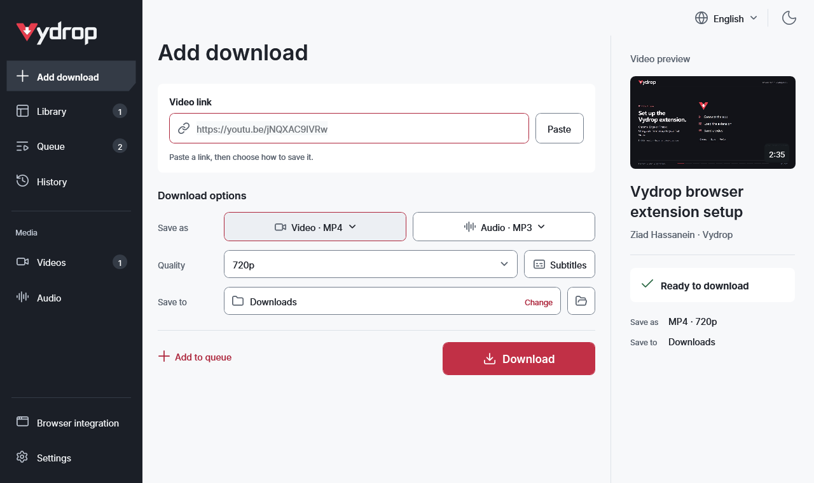

# Download and install Vydrop for Windows

**Vydrop is a free, open-source video and audio downloader for Windows 10/11 x64.** Download the packaged app from the project's GitHub Releases page. The desktop interface supports English and Arabic.

[Download Vydrop 4.4.1 — Windows installer](https://github.com/ZiadHassanein/Vydrop/releases/download/v4.4.1/VydropSetup-v4.4.1-win-x64.exe) · [Portable ZIP](https://github.com/ZiadHassanein/Vydrop/releases/download/v4.4.1/Vydrop-v4.4.1-win-x64.zip) · [Release notes](https://github.com/ZiadHassanein/Vydrop/releases/tag/v4.4.1)

## Install Vydrop

1. Run **VydropSetup-v4.4.1-win-x64.exe**. Installation is for your Windows account and does not need administrator rights.
2. Open **Vydrop** from Start. Setup installs the app, creates its uninstaller and registers the browser connection automatically.
3. To add the optional companion, open **Settings → Browser integration**. Store listings are still pending: choose **Manual setup and troubleshooting → Load the local companion**, finish the browser's loading step, then use **Test connection**.

The installer closes the setup gap on the app side. Your browser still requires approval to load an extension. See the [illustrated extension guide](browser-extension-setup.md).

## Choose the application package

| Item | What you need |
| --- | --- |
| Operating system | Windows 10 or Windows 11, x64 |
| Installer | `VydropSetup-v4.4.1-win-x64.exe` from GitHub Releases |
| Portable app | `Vydrop-v4.4.1-win-x64.zip`; extract the complete folder |
| .NET | Included in the package; no separate runtime installation |
| Media tools | Missing tools are prepared when needed; first use needs an internet connection |
| Browser companion | Optional Chrome, Edge or Firefox companion, inside the app's **Browser** folder |
| Account or payment | No Vydrop account, API key or subscription |

GitHub's **Code → Download ZIP** downloads the source code. Choose the named Windows ZIP under **Releases → Assets** for the ready-to-run app. There is no native macOS or Linux package in this release.

## Run the extracted app

1. Extract the complete ZIP to a permanent writable folder, such as **Documents\Vydrop**.
2. Open **Vydrop.exe** from the extracted folder. Keep **Browser** beside it if you want browser integration.
3. Paste a public video's own link. Wait for its title and available quality, choose Video or Audio, then choose **Download**.
4. For browser handoff, follow the [illustrated extension guide](browser-extension-setup.md).

The companion opens a format and quality menu. Confirm Download to start the chosen output in your saved folder; older app versions open a review screen. Vydrop does not import browser cookies or unlock private or DRM-protected media. See [supported sites and limitations](supported-sites.md).

## Check the publisher and package

The official repository is **[ZiadHassanein/Vydrop](https://github.com/ZiadHassanein/Vydrop)**, maintained by Ziad Hassanein. Review its release notes and asset details before running a package. The current Windows executable is **not Authenticode-signed**. A checksum or GitHub asset digest can detect a changed download relative to that publisher; it is not independent proof that a package is safe. Read the [security policy](https://github.com/ZiadHassanein/Vydrop/blob/main/SECURITY.md) for the full trust boundary.

## Update an existing copy

Close Vydrop, then run the new installer to update an installed copy. For a portable copy, extract the complete new ZIP and run its executable. Existing settings, queue and history remain in their compatible storage location. If you move a portable copy, open **Settings → Browser integration** and reconnect from that copy; reload the companion from its Browser folder.

Versions through **4.2.1** need one manual download after the repository was renamed from ViFree to Vydrop. Application updates and media-tool updates are separate: **Settings → Update downloader** checks the media tools, not the desktop application package.

Settings and recent-file history use `%LocalAppData%\YouTubeDownloader` for compatibility. Your media files remain in your chosen save folder. See [troubleshooting](troubleshooting.md) if the app cannot check a video or the companion shows Try again.

## Continue

[Save YouTube audio as MP3](youtube-to-mp3-windows.md) · [Download playlist entries](download-youtube-playlist-windows.md) · [Save subtitles](youtube-subtitles-srt.md) · [About Vydrop](about.md)

<figure><figcaption>Add download opens in the main workspace. These are native 4.4.1 controls with example media.</figcaption></figure>
